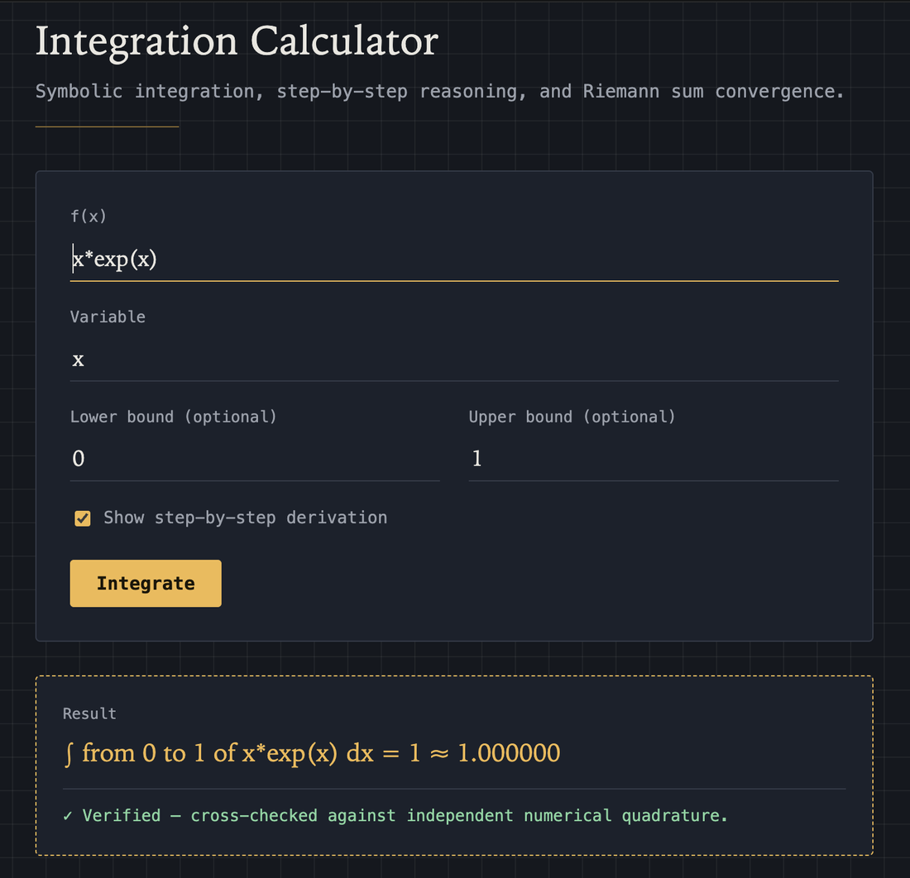
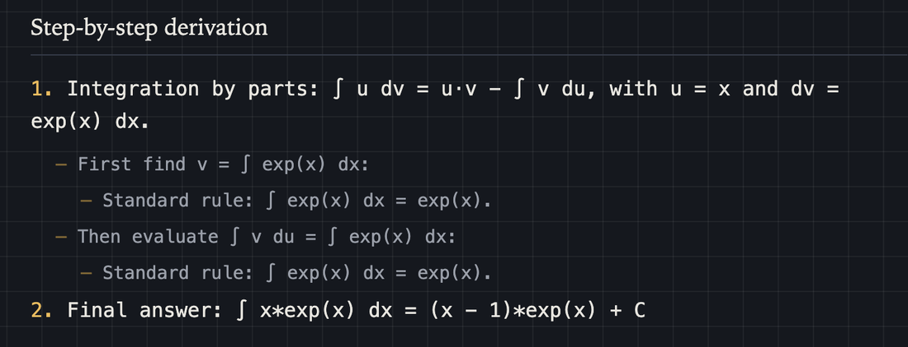
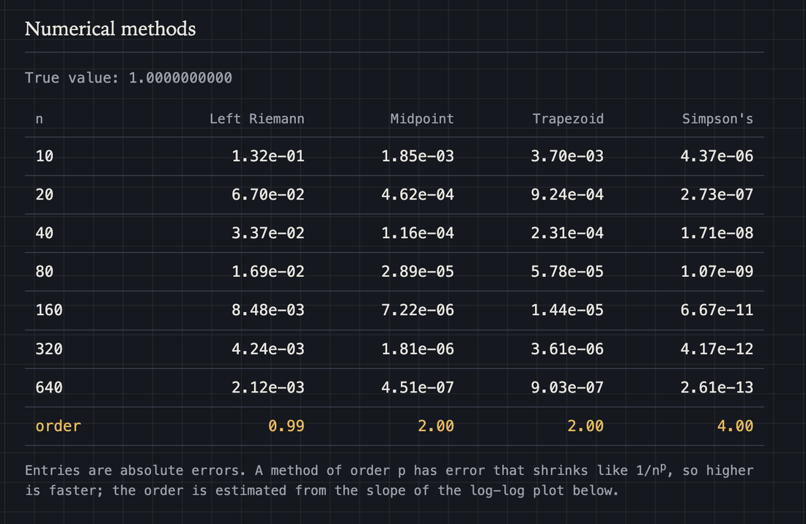
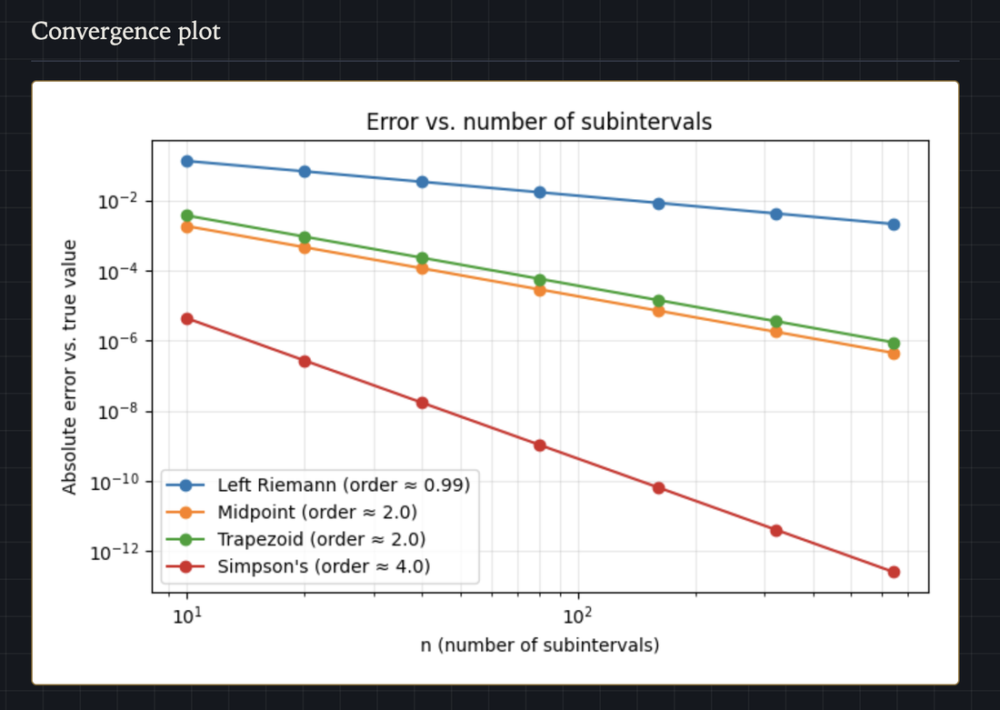
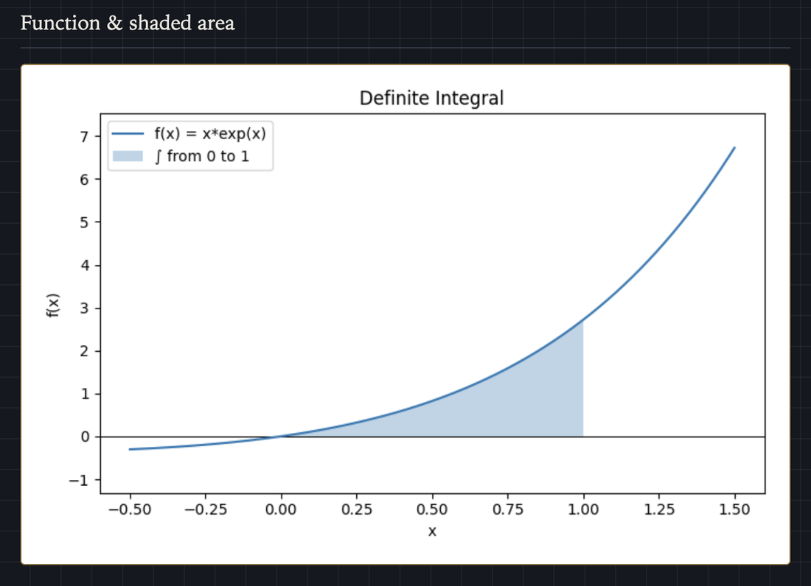

# Integration Calculator

[](https://github.com/tuff4k47/projects/actions/workflows/tests.yml)

Integration Calculator is a Python program, available as a command-line tool
and as a small Flask web app, that integrates a function you type in ordinary
math notation (`x**2 + 3*x`, `2x^2`, `x*exp(x)`, `1/(x**2 + 1)`, `exp(-x**2)`).
It computes either the **indefinite integral** (the antiderivative, `+ C`) or
the **definite integral** over bounds `a, b` (which may be `-oo` or `oo`).

What makes it more than a wrapper around a library:

- **It checks its own answers.** An antiderivative is verified by
  differentiating it and confirming the original function comes back. A
  definite integral is cross-checked against an independent numerical
  quadrature. The result is shown as "Verified", "Check failed" or "Not
  verified" with the reason.
- **It explains the steps.** The step-by-step output names the rule used at
  each stage, including **u-substitution**, **integration by parts**
  (applied repeatedly when needed), rewriting, and trigonometric
  substitution, with nested steps indented.
- **It is honest when there is no closed form.** Many integrals (for example
  `exp(sin(x))`) have no elementary antiderivative. The calculator says so,
  and for a definite integral it still gives a numerical value, including over
  infinite bounds.
- **It compares numerical methods.** For a definite integral it runs the left
  Riemann sum, midpoint rule, trapezoid rule and Simpson's rule for a doubling
  sequence of subinterval counts `n`, shows each method's error, and
  **estimates each method's order of accuracy** from the slope of the log-log
  error plot. You can see that left Riemann converges like `1/n`, midpoint
  and trapezoid like `1/n^2`, and Simpson like `1/n^4`.
- **It is safe to put on a web page.** Input is never run as Python, and no
  calculation can freeze the program (details below).

## Screenshots

The web app (`python3 app.py`) showing a definite integral with its verification
line:



Step-by-step output, with integration by parts and its nested sub-steps:



Four numerical methods compared. The `order` row is estimated from the error
data, and matches theory (1, 2, 2 and 4):



The same data on a log-log plot, where each method is a straight line whose
slope is its order of accuracy:



The function with the integration interval shaded:



## How it works

### Safe parsing (`safe_parse`)
SymPy's usual `parse_expr` ends in Python's `eval`, which would let anyone who
can reach the web page run code. Instead, the text is first rewritten by
SymPy's own transformations (so `2x^2` and `sin x` still work). The resulting
code is then parsed into a syntax tree and checked against a whitelist: only
arithmetic, numbers, and a fixed list of math functions (`sin`, `exp`, `log`,
`sqrt`, `Abs`, `floor`, `frac`, `Max`, ...) are allowed. Attribute access,
subscripts, lambdas, comprehensions, strings, double underscores, and calls to
anything else are rejected. The final `eval` runs with no builtins. Variable
names, expression length and tree size are also limited.

### Timeouts (`run_with_timeout`, `analyze_problem`)
Some integrals make SymPy run effectively forever, and in a web server one such
request would freeze everything. Heavy work therefore runs in a separate
process that is killed after 10 seconds (it is also memory-limited on Unix).
The work is split into stages: first the answer itself (parse and integrate),
then optional extras (the check, the steps, the numerical comparison, the
plots), each in its own process within a shared time budget. If an extra takes
too long it is reported as such, but you still get the answer. Only a stuck
answer produces a "took longer than 10 seconds" message.

### Integration and the numeric fallback
`compute_indefinite_integral` and `compute_definite_integral` call SymPy's
`integrate`. If it returns an unevaluated `Integral`, there is no closed form,
and for definite integrals the value comes from `mpmath.quad` (tanh-sinh
quadrature), which copes with infinite limits and endpoint singularities. For
integrands containing `floor`, `ceiling` or `frac`, the interval is split at
the integers, where those functions jump, so the quadrature never straddles a
jump. Results that diverge, are complex, or fail to converge are reported in
words, never as a crash.

### Verification
`verify_antiderivative` differentiates the answer and asks SymPy whether the
difference from the original function simplifies to zero; if not, it compares
them numerically at several test points. `verify_definite` compares the exact
value to independent numerical quadrature. Where neither check is conclusive
(for example integrands with kinks) the result says "Not verified" rather than
guessing.

### Step-by-step derivations
`generate_steps` uses the rule tree from SymPy's `manualintegrate` module,
which records how a textbook solution would proceed, and turns it into
sentences: sum rule, constant multiple rule, power rule, reciprocal rule,
u-substitution (with `du` and the back-substitution), integration by parts
(with `u`, `dv`, `v` and the remaining integral), rewriting, and more. If no
textbook rule applies, it falls back to a simpler pattern-matching explanation
and then says SymPy's general algorithm was used. The final answer always comes
from `integrate`, so the steps explain the answer rather than produce it.

### Numerical methods and convergence order
`numerical_integral` implements five methods with NumPy. `compare_methods`
evaluates each for `n = 10, 20, 40, ..., 640` against the best available true
value (the exact one when SymPy has it, otherwise quadrature). If the error
behaves like `C / n^p`, then `log(error)` is a straight line in `log(n)` with
slope `-p`, so `estimate_order` fits that line. It reports `exact` when errors
are already at machine precision (Simpson's rule is exact for cubics) and
`irregular` when the points do not follow a power law (jumps, kinks), instead
of printing a misleading number. Methods that cannot be evaluated, such as
the trapezoid rule on `1/sqrt(x)` over `[0, 1]` where the integrand is
infinite at an endpoint, are skipped.

### Two interfaces, one engine
`project.py` (CLI) and `app.py` (web) both call `analyze_problem` in
`integrator.py` and only differ in presentation, so they never disagree.
The web app shows the result, check, steps, comparison table and two plots
(embedded as base64 PNGs, so nothing is written to the server's disk). The CLI
can save the plots as PNG files.

## Files

- `integrator.py`: the engine: safe parsing, timeouts, integration, numeric
  fallback, verification, steps, numerical methods, plotting, and
  `analyze_problem`.
- `project.py`: the command-line interface: `main()` plus helper functions
  (`ask`, `ask_yes_no`, `interpret_yes_no`, `parse_bounds`, `format_report`,
  `format_comparison_table`, `save_plot`).
- `app.py` and `templates/index.html`: the Flask web app and its single page.
- `test_project.py`: 162 automated tests (see below).
- `sample_problems.txt`: 20 integrals, from routine to "integral bee" tricks,
  ready to paste into the calculator, with notes and checked answers.
- `requirements.txt` and `requirements-dev.txt`: pinned runtime dependencies, and the
  same plus `pytest` for running the tests.
- `.gitignore`: keeps caches, virtual environments, `.env` and generated plots out of git.
- `LICENSE`: MIT license.
- `docs/`: the screenshots used in this README.
- `.github/workflows/`: continuous integration (see Tests below).

## How to run it

```
pip install -r requirements.txt
python3 project.py          # command line
python3 app.py              # web app, then open http://127.0.0.1:5000
```

The dependency versions in `requirements.txt` are pinned to the ones the tests
passed on, using Python 3.13. On an older Python you may need to loosen a pin
(for example `numpy`).

(`flask --app app run` also works.) Run both from inside the `project` folder
so Flask can find `templates/`. Flask's debug mode is off unless you set
`FLASK_DEBUG=1`, because its debugger lets anyone who can reach it run code.

Example command-line session:

```
f(x) = x*exp(x)
Variable to integrate with respect to [x]:
Bounds 'a,b' for a definite integral ..., or Enter for indefinite: 0,1
Show step-by-step derivation? [y/N]: y
Compare numerical methods (Riemann, trapezoid, Simpson)? [y/N]: y
Save plots as PNG files? [y/N]: n

∫ from 0 to 1 of x*exp(x) dx = 1  ≈ 1.000000
✓ Verified: cross-checked against independent numerical quadrature.

Step-by-step:
1. Integration by parts: ∫ u dv = u·v − ∫ v du, with u = x and dv = exp(x) dx.
   - First find v = ∫ exp(x) dx:
      - Standard rule: ∫ exp(x) dx = exp(x).
   - Then evaluate ∫ v du = ∫ exp(x) dx:
      - Standard rule: ∫ exp(x) dx = exp(x).
2. Final answer: ∫ x*exp(x) dx = (x - 1)*exp(x) + C

     n |   Left Riemann |       Midpoint |      Trapezoid |      Simpson's
    10 |       1.32e-01 |       1.85e-03 |       3.70e-03 |       4.37e-06
   640 |       2.12e-03 |       4.51e-07 |       9.03e-07 |       2.61e-13
 order |           0.99 |           2.00 |           2.00 |           4.00
```

## Tests

```
pip install -r requirements-dev.txt     # runtime requirements plus pytest
pytest test_project.py
```

GitHub Actions runs the suite on every push and pull request (`tests.yml`):
a lint check with `ruff`, the tests on Linux, macOS and Windows with the pinned
dependencies, and a smoke test that drives the real command-line program. A
second workflow (`latest-deps.yml`) runs weekly against the newest versions of
every dependency, so upstream changes show up as an early warning rather than
a surprise. (Windows is informational for now: the process isolation uses
Python's `spawn` start method there, which I have not been able to verify
locally.)

The 162 tests (many parametrized) cover: every command-line helper; the parser
accepting ordinary math and rejecting 17 hostile inputs (including attempts to
open files and walk Python's object graph) without executing them; timeouts
stopping a hung integral and a power-tower attack; exact and numeric
integration, divergence and infinite bounds; verification accepting correct
answers and rejecting a wrong one; each numerical method and its measured
order of accuracy; u-substitution and integration-by-parts steps; all 20 sample
problems (none may crash, and six have checked answers); and the Flask routes,
including hostile input and a timeout. The full run takes about 80 seconds,
mostly because two sample problems are deliberately slow.

## Design choices and limits

- **Why SymPy instead of writing an integrator?** Symbolic integration is hard
  (the Risch algorithm took decades). I used SymPy for the algebra and spent
  the effort on what surrounds it: safe input, never freezing, checking the
  answer, explaining it, and comparing numerical methods.
- **Why a whitelist parser and not just `parse_expr`?** `parse_expr` calls
  `eval`. A whitelist over the syntax tree means the web page can only ever do
  arithmetic on known functions.
- **Why subprocesses for timeouts?** Python cannot reliably interrupt a long
  computation inside a thread, but it can kill a process. The workers start
  from a pre-loaded server (`forkserver`), so each call costs milliseconds.
- **Why separate stages?** A slow explanation should never cost the person
  their answer. Verified on the samples: the answer to #19 takes half a
  second, but SymPy's step rules need more than the budget, so the steps are
  skipped and the answer is shown.
- **Limits worth knowing.**
  - The steps come from SymPy's rule tree, so they can time out on complicated
    integrands and may differ from how a person would solve it.
  - A "Verified" mark is only as strong as the check behind it: differentiating
    and simplifying, or numerical agreement to about six digits.
  - Splitting at integers handles `floor(x)` and `frac(x)` but not
    `floor(2*x)`, which jumps at half-integers.
  - The sandboxing (whitelist, timeout, memory cap) is solid for a course
    project and a local web app. A public deployment would also want rate
    limiting and a container.

## Possible future improvements

- Render results with MathJax/LaTeX instead of plain text.
- A dropdown in the web UI that loads the sample problems.
- Multivariable (double) integrals.
- A true rule-based engine of my own instead of SymPy's `manualintegrate`.

## License

MIT License. See [LICENSE](LICENSE). Copyright (c) 2026 Samuel Neo.
